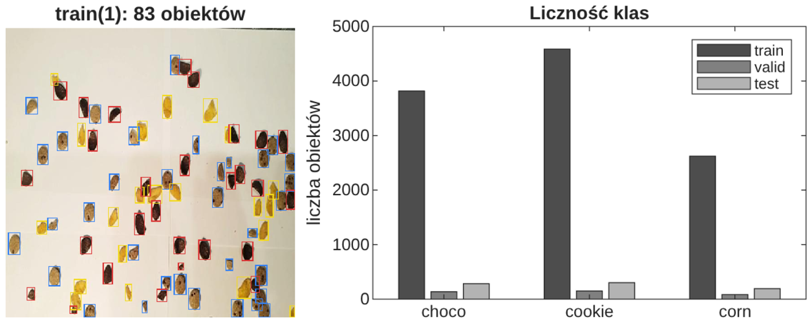
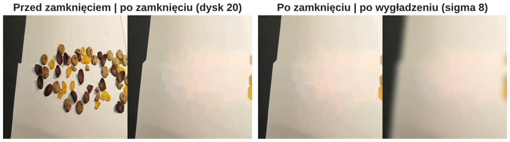
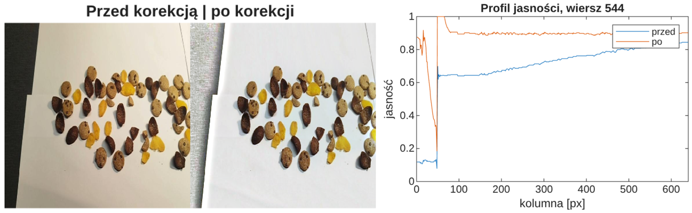
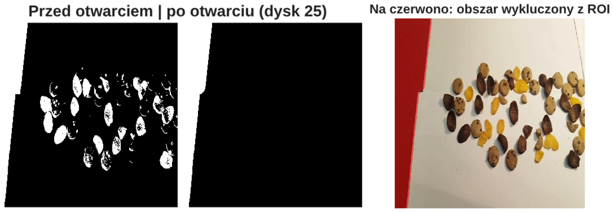

# Cel

Chcemy automatycznie rozpoznawać na zdjęciach trzy rodzaje płatków śniadaniowych: **choco** (ciemnobrązowe), **cookie** (jasnobrązowe ciasteczka) i **corn** (żółte płatki kukurydziane). Płatki leżą na białym papierze i są fotografowane z góry.

To sprawozdanie opisuje dwa pierwsze kroki: **wczytanie danych** i **przetwarzanie wstępne**, czyli poprawienie zdjęć tak, żeby w następnych krokach łatwiej było rozpoznać płatki po kolorze.

# Etap 1: wczytanie danych

**Skąd dane.** Zbiór *Mlekolaki v3* to nasze własne dane. Nagraliśmy filmy z płatkami, wybraliśmy z nich klatki i w programie [Roboflow](https://roboflow.com) [3] zaznaczyliśmy ręcznie każdy płatek prostokątem (tzw. **ramką**) z nazwą klasy. Roboflow zapisał te opisy w standardowym formacie [**COCO**](https://cocodataset.org/#format-data), czyli w pliku JSON z listą obrazów, ramek i klas.

Obrazy są kolorowe (RGB), mają rozmiar 640 × 640 px i przeszły dodatkową [augmentację](https://en.wikipedia.org/wiki/Data_augmentation) poprzez losowe odbicie, przycięcie (do 22%) i obrót (do ±15°). Dzięki temu z każdego zdjęcia powstały 3 różne wersje, a zbiór jest większy.

Zbiór jest podzielony na trzy części: **train** do uczenia, **valid** do dobierania parametrów i **test** do końcowej oceny.

| Podzbiór | Obrazy | Płatki (ramki) |
|----------|-------:|--------:|
| train    | 144    | 11026   |
| valid    | 6      | 373     |
| test     | 13     | 780     |

{width=95%}

# Etap 2: przetwarzanie wstępne

## Jakie problemy rozwiązujemy

1. **Nierówne oświetlenie.** Papier powinien być wszędzie tak samo biały, ale na zdjęciu jest jaśniejszy z jednej strony i ciemniejszy z drugiej (np. lampa z boku, cień ręki lub telefonu). Przez to ten sam płatek w jasnym miejscu ma inny kolor niż w ciemnym. Model, który rozpoznaje płatki po kolorze, by się wtedy mylił.
2. **Ciemne tło poza kartką.** Na brzegach zdjęć widać stół lub ciemny materiał. Ma on podobny kolor do płatków choco, więc mógłby zostać wzięty za płatki.

Przetwarzanie wstępne daje dwa wyniki:

- **`J`**: poprawiony obraz z wyrównanym oświetleniem (część A),
- **`roi`**: maskę „gdzie szukać płatków”, czyli obraz czarno-biały, w którym prawda (1) oznacza papier, a fałsz (0) ciemne tło do pominięcia (część B).

## Część A: wyrównanie oświetlenia

**Pomysł** [1, 6]**.** Jasność piksela na zdjęciu to w przybliżeniu *kolor przedmiotu × ilość światła w tym miejscu*. Jeśli poznamy, ile światła pada na każde miejsce (**mapa oświetlenia**), to dzieląc przez nią obraz, zostanie sam kolor przedmiotu, niezależny od oświetlenia. Dzielimy, a nie odejmujemy, właśnie dlatego, że światło *mnoży* jasność.

Mapę oświetlenia odczytujemy z papieru, bo wiemy, że jest wszędzie biały. Jeśli w jakimś miejscu wygląda na ciemniejszy, to znaczy, że pada tam mniej światła. Problem w tym, że papier jest zasłonięty płatkami, więc najpierw trzeba płatki „wymazać” (kroki A1–A3).

**A1. Zmniejszenie obrazu o połowę** ([`imresize`](https://www.mathworks.com/help/matlab/ref/imresize.html), do 320 × 320 px). Oświetlenie zmienia się na obrazie bardzo łagodnie, więc nie potrzebujemy pełnej rozdzielczości, żeby je zmierzyć. Na mniejszym obrazie następne operacje liczą się kilka razy szybciej.

**A2. [Zamknięcie morfologiczne](https://en.wikipedia.org/wiki/Closing_(morphology))** ([`imclose`](https://www.mathworks.com/help/images/ref/imclose.html) [1, 2], [element strukturalny](https://en.wikipedia.org/wiki/Structuring_element) w kształcie koła o promieniu 20 px, [`strel("disk", 20)`](https://www.mathworks.com/help/images/ref/strel.html)). Zamknięcie to dwie operacje po kolei:

- [*dylatacja*](https://en.wikipedia.org/wiki/Dilation_(morphology)): każdy piksel dostaje najjaśniejszą wartość ze swojego otoczenia (koła). Jasny papier „rozlewa się” na płatki i je zakrywa;
- [*erozja*](https://en.wikipedia.org/wiki/Erosion_(morphology)): każdy piksel dostaje najciemniejszą wartość z otoczenia. Przywraca to właściwy kształt dużym obszarom (np. brzeg kartki), ale małe płatki już nie wracają, bo zostały całkiem zakryte.

W efekcie znikają wszystkie ciemne obiekty mniejsze od koła, a zostaje sam papier ze swoimi cieniami. **Dlaczego promień 20 px?** Na zmniejszonym obrazie to koło o średnicy 40 px, co odpowiada 80 px w pełnej rozdzielczości. Jest więc ponad dwa razy większe od typowego płatka (34 px), więc płatki na pewno znikną, nawet gdy kilka leży obok siebie.

**A3. Rozmycie [filtrem Gaussa](https://en.wikipedia.org/wiki/Gaussian_blur)** ([`imgaussfilt`](https://www.mathworks.com/help/images/ref/imgaussfilt.html) [1, 4], σ = 8). Po zamknięciu w miejscach, gdzie były płatki, zostają kanciaste plamy (widać je na rysunku poniżej, w środku). Prawdziwe oświetlenie zmienia się płynnie, więc rozmywamy mapę, żeby była gładka. σ = 8 to „szerokość” rozmycia: na tyle duża, żeby usunąć plamy, ale na tyle mała, żeby zostawić łagodne zmiany jasności.

{width=100%}

**A4. Powiększenie mapy** (`imresize`) z powrotem do 640 × 640 px, żeby pasowała do oryginalnego obrazu piksel w piksel.

**A5. Dzielenie obrazu przez mapę oświetlenia:**

$$J = \min\left(1,\ 0.9 \cdot \frac{I}{\max(\text{mapa},\ 0.05)}\right)$$

- Dzielimy każdy kanał koloru (R, G, B) osobno, więc wyrównuje się też odcień (np. żółtawe światło lampy).
- Mnożymy przez **0.9**, żeby papier miał wszędzie jasność 0.9, a nie 1. Zostaje zapas, żeby piksele odrobinę jaśniejsze od papieru nie zrobiły się całkiem białe i nie straciły koloru.
- **max(mapa, 0.05)** zabezpiecza przed dzieleniem przez prawie zero w bardzo ciemnych miejscach (np. na czarnym stole), gdzie wynik wyszedłby ogromny.
- **min(1, …)** obcina wynik do maksymalnej możliwej jasności.

Efekt widać na wykresie po prawej, czyli na jasności pikseli wzdłuż jednej poziomej linii obrazu. **Przed** korekcją (niebieska linia) papier stopniowo jaśnieje od 0.64 do 0.84. **Po** korekcji (pomarańczowa linia) papier ma wszędzie ok. 0.9, a spadki jasności są tylko tam, gdzie leżą płatki.

{width=100%}

## Część B: obszar, w którym szukamy płatków (ROI)

[ROI](https://en.wikipedia.org/wiki/Region_of_interest) (*region of interest*, obszar zainteresowania) to maska mówiąca, które piksele należą do kartki. Chcemy z niej wyrzucić ciemne tło poza kartką. Kroki B1–B3 liczymy na **oryginalnym** obrazie, bo po korekcji z części A ciemne tło zostało sztucznie rozjaśnione (widać to na wykresie wyżej, po lewej stronie) i trudniej je odróżnić.

**B1. [Progowanie](https://en.wikipedia.org/wiki/Thresholding_(image_processing))** ([`rgb2gray`](https://www.mathworks.com/help/matlab/ref/rgb2gray.html), próg 0.3) [1, 5]. Zamieniamy obraz na odcienie szarości i zaznaczamy piksele ciemniejsze niż 0.3 (w skali od 0 = czarny do 1 = biały). Papier ma jasność 0.6–0.9, a tło ok. 0.1, więc próg 0.3 dobrze je rozdziela. Niestety zaznaczają się też ciemne płatki choco (lewa część rysunku poniżej).

**B2. [Otwarcie morfologiczne](https://en.wikipedia.org/wiki/Opening_(morphology))** ([`imopen`](https://www.mathworks.com/help/images/ref/imopen.html) [1, 2], koło o promieniu 25 px). To odwrotność zamknięcia: najpierw *erozja*, potem *dylatacja*. Erozja „zjada” każdy zaznaczony obszar od brzegów o 25 px. Płatki są zwykle węższe niż 50 px, więc znikają całkiem. Duże tło tylko się trochę zmniejsza, a dylatacja przywraca mu pierwotny rozmiar. Zostaje samo tło poza kartką (środkowa część rysunku). **Dlaczego 25 px?** Średnica koła to 50 px, czyli dużo więcej niż typowy płatek (34 px), więc płatki znikają z maski. Jednocześnie koło jest dużo mniejsze od pasa tła na brzegu zdjęcia, więc tło zostaje.

**B3. Lekkie poszerzenie i odwrócenie** ([`imdilate`](https://www.mathworks.com/help/images/ref/imdilate.html), koło o promieniu 6 px, potem negacja `~`). Na samym brzegu kartki jest wąski pas cienia, który nie jest ani papierem, ani tłem. Poszerzamy maskę tła o 6 px, żeby ten pas też został pominięty. Na koniec odwracamy maskę: ROI to wszystko, co **nie jest** tłem.

{width=100%}

## Podsumowanie: operacje, parametry i powód ich wyboru

| Krok | Co robimy | Parametr | Dlaczego |
|:-----|:--------------|:-----------|:-------------------------|
| A1 | zmniejszenie obrazu | połowa rozmiaru | oświetlenie zmienia się łagodnie, a liczy się szybciej |
| A2 | zamknięcie | koło r = 20 px | „wymazuje” płatki (koło 2× większe od płatka), zostaje papier |
| A3 | rozmycie Gaussa | σ = 8 | usuwa kanciaste plamy, mapa oświetlenia jest gładka |
| A4 | powiększenie | 640 × 640 | mapa musi pasować do obrazu |
| A5 | dzielenie przez mapę | papier → 0.9 | usuwa wpływ oświetlenia, kolor płatka jest wszędzie taki sam |
| B1 | progowanie | jasność < 0.3 | zaznacza ciemne miejsca (tło i choco) |
| B2 | otwarcie | koło r = 25 px | usuwa płatki choco z maski, zostaje samo tło |
| B3 | poszerzenie i odwrócenie | koło r = 6 px | pomija też cień na brzegu kartki |

W demo sprawdziliśmy, że wynik liczony ręcznie krok po kroku jest identyczny z wynikiem funkcji `preprocess`.

# Bibliografia

1. R. C. Gonzalez, R. E. Woods, *Digital Image Processing*, wyd. 4, Pearson, 2018. Rozdz. 3 (filtracja przestrzenna, progowanie) i rozdz. 9 (morfologia).
2. M. Iwanowski, S. Skoneczny, *Przetwarzanie i rozpoznawanie obrazów: preskrypt*, Politechnika Warszawska, 2009 (materiał do wykładu, plik `Liniowe_i_Morfologia.pdf`). Morfologia matematyczna: erozja, dylatacja, otwarcie, zamknięcie.
3. Roboflow: narzędzie do opisu i augmentacji zbiorów obrazów, <https://roboflow.com>. Format danych COCO: <https://cocodataset.org/#format-data>.
4. *Przemysłowe Systemy Wizyjne*: wykład „Filtry liniowe przestrzenne”, 2025. Filtr Gaussa.
5. *Przemysłowe Systemy Wizyjne*: wykład 1, 2025. Akwizycja obrazu, oświetlenie, binaryzacja.
6. Dokumentacja MATLAB Image Processing Toolbox, przykład „Correct Nonuniform Illumination and Analyze Foreground Objects”, <https://www.mathworks.com/help/images/correcting-nonuniform-illumination.html>.

**Opisy operacji w internecie:**

- Morfologia matematyczna: [ogólnie](https://en.wikipedia.org/wiki/Mathematical_morphology), [erozja](https://en.wikipedia.org/wiki/Erosion_(morphology)), [dylatacja](https://en.wikipedia.org/wiki/Dilation_(morphology)), [otwarcie](https://en.wikipedia.org/wiki/Opening_(morphology)), [zamknięcie](https://en.wikipedia.org/wiki/Closing_(morphology)), [element strukturalny](https://en.wikipedia.org/wiki/Structuring_element).
- Filtracja i progowanie: [filtr Gaussa](https://en.wikipedia.org/wiki/Gaussian_blur), [progowanie](https://en.wikipedia.org/wiki/Thresholding_(image_processing)).
- Funkcje MATLAB: [`imresize`](https://www.mathworks.com/help/matlab/ref/imresize.html), [`imclose`](https://www.mathworks.com/help/images/ref/imclose.html), [`imopen`](https://www.mathworks.com/help/images/ref/imopen.html), [`imdilate`](https://www.mathworks.com/help/images/ref/imdilate.html), [`imerode`](https://www.mathworks.com/help/images/ref/imerode.html), [`strel`](https://www.mathworks.com/help/images/ref/strel.html), [`imgaussfilt`](https://www.mathworks.com/help/images/ref/imgaussfilt.html), [`rgb2gray`](https://www.mathworks.com/help/matlab/ref/rgb2gray.html).
