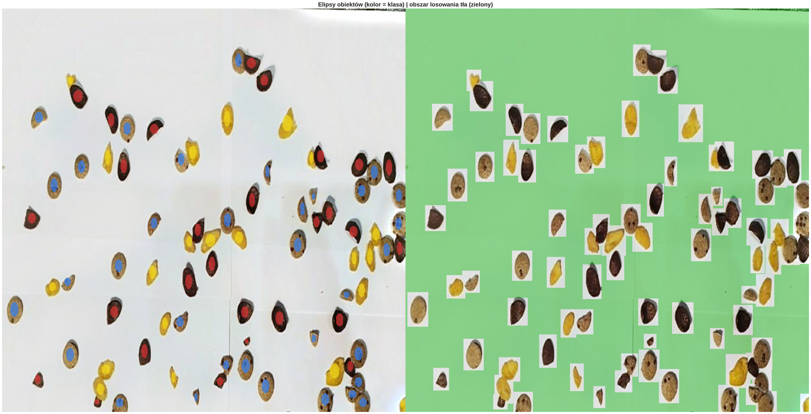
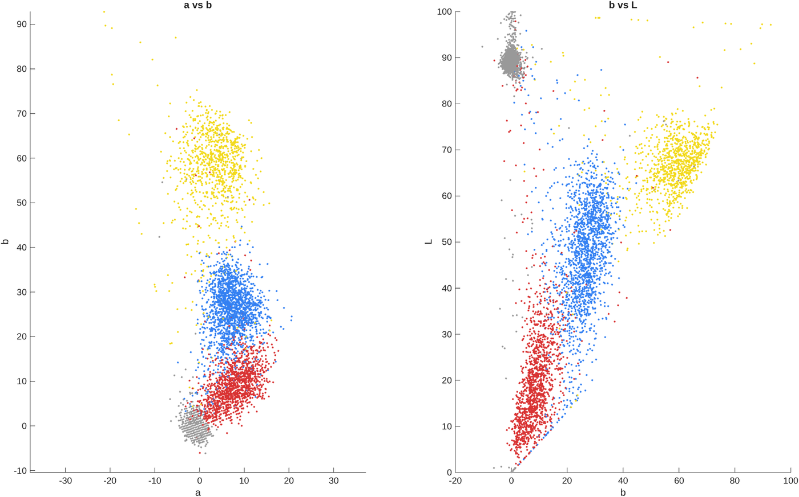
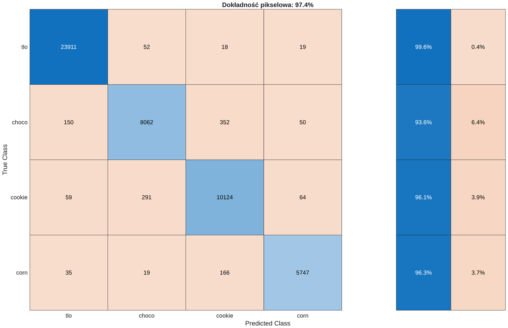
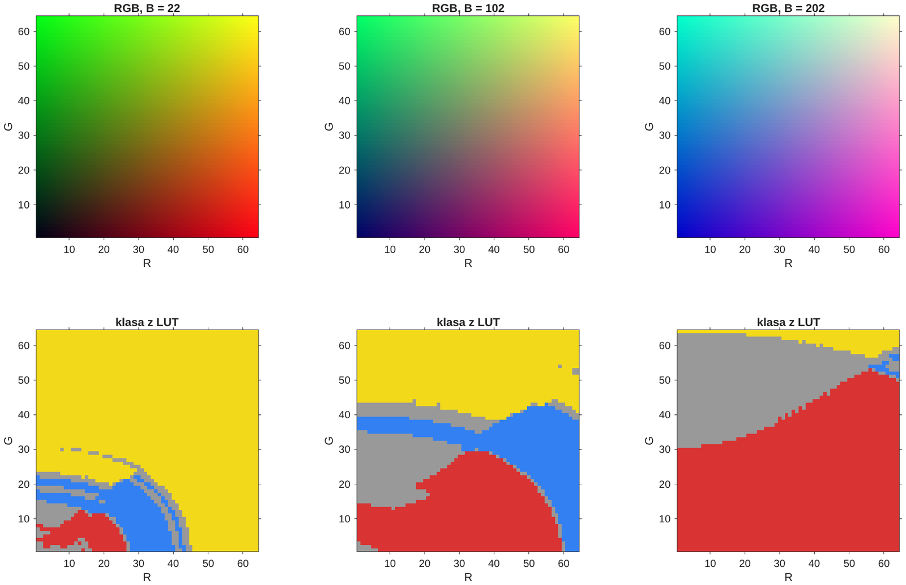
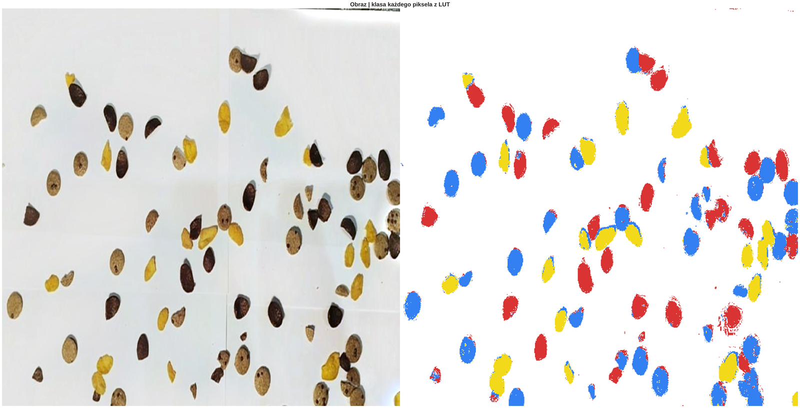

# Cel

Chcemy nauczyć komputer rozpoznawać, do której klasy należy piksel, patrząc **tylko na jego kolor**. Klasy to: tło (papier), choco, cookie i corn. Model uczymy na obrazach po przetwarzaniu wstępnym z etapu 2 (wyrównane oświetlenie, maska ROI), korzystając z ramek, którymi ręcznie zaznaczyliśmy płatki na 144 obrazach treningowych.

# Model koloru

**Próbki do uczenia.** Model uczy się na przykładach: „ten kolor to choco, ten to tło”. Przykłady bierzemy z ramek:

- **Piksele płatka** losujemy z elipsy w środku ramki, o połowę mniejszej od ramki (40 pikseli z każdego płatka). Ramka to prostokąt, a płatek jest owalny, więc w rogach ramki jest papier i cień. Środek ramki to prawie na pewno sam płatek.
- **Piksele tła** (3000 z każdego obrazu) losujemy poza wszystkimi ramkami (lekko poszerzonymi o 3 px), ale wewnątrz maski ROI z etapu 2, żeby nie brać ciemnego stołu.

W demo, na 40 obrazach, zebrano ok. 245 tys. próbek (49% tło, 18% choco, 21% cookie, 12% corn).

{width=80%}

**Przestrzeń barw Lab.** Zamiast surowych wartości R, G, B używamy przestrzeni [**Lab**](https://en.wikipedia.org/wiki/CIELAB_color_space) ([`rgb2lab`](https://www.mathworks.com/help/images/ref/rgb2lab.html)) [1]. Ma ona trzy składowe: **L** = jasność, **a** = odcień od zielonego do czerwonego, **b** = odcień od niebieskiego do żółtego. Zaleta jest taka, że jasność jest oddzielona od odcienia, a odległości w Lab lepiej odpowiadają temu, jak człowiek odbiera różnice kolorów. Na wykresie widać, że klasy tworzą osobne „chmury”: corn ma duże b (żółty), choco małe L (ciemny), a tło duże L i a, b bliskie zera (biały, bez odcienia). Chmury choco i cookie częściowo na siebie zachodzą, bo oba są brązowe.

{width=60%}

**Klasyfikator.** Używamy zespołu 40 [drzew decyzyjnych](https://en.wikipedia.org/wiki/Decision_tree_learning) uczonych metodą [**bagging**](https://en.wikipedia.org/wiki/Bootstrap_aggregating) ([`fitcensemble`](https://www.mathworks.com/help/stats/fitcensemble.html), [`templateTree`](https://www.mathworks.com/help/stats/templatetree.html)) [2, 3, 4]:

- *drzewo decyzyjne* to seria prostych pytań typu „czy L < 40?”, „czy b > 50?”, które prowadzą do odpowiedzi „to jest corn”;
- *bagging*: każde drzewo uczy się na innej, losowo wybranej części próbek, a na koniec drzewa **głosują**. Pojedyncze drzewo łatwo „uczy się na pamięć” przypadkowych szczegółów, a głosowanie wielu drzew daje stabilniejszy wynik;
- każdy liść drzewa musi zawierać co najmniej 20 próbek, żeby drzewa nie dzieliły danych na zbyt drobne kawałki.

Żeby sprawdzić model uczciwie, 20% próbek odkładamy przed uczeniem ([`cvpartition`](https://www.mathworks.com/help/stats/cvpartition.html)) i testujemy na nich model. Wynik pokazuje [macierz pomyłek](https://en.wikipedia.org/wiki/Confusion_matrix): wiersz to prawdziwa klasa, kolumna to odpowiedź modelu, a liczby poza przekątną to błędy. Dokładność wynosi **97.4%**. Najczęściej mylone są choco i cookie, co pasuje do zachodzących chmur na wykresie Lab.

{width=55%}

**Tablica LUT.** Pytanie 40 drzew o każdy z 409 600 pikseli każdego obrazu byłoby wolne. Dlatego pytamy model tylko raz, o każdy możliwy kolor, i zapisujemy odpowiedzi w [tablicy LUT](https://en.wikipedia.org/wiki/Lookup_table) (*look-up table*). Żeby tablica nie była za duża, każdą składową R, G, B dzielimy na 64 przedziały (zamiast 256), co daje 64³ ≈ 262 tys. kolorów. Klasyfikacja obrazu to wtedy tylko odczytanie z tablicy wartości dla koloru każdego piksela.

Jeśli mniej niż 60% drzew głosuje na tę samą klasę, model „nie jest pewny”. Takie kolory (ok. 10%, głównie szarości, czyli cienie) zapisujemy jako tło, bo lepiej pominąć cień, niż wziąć go za płatek.

{width=70%}

{width=80%}

Model z demo (40 obrazów) zgadza się z pełnym modelem, uczonym na wszystkich 144 obrazach, w 89.4% komórek LUT.

# Bibliografia

1. R. C. Gonzalez, R. E. Woods, *Digital Image Processing*, wyd. 4, Pearson, 2018. Rozdz. 6 (przetwarzanie obrazów kolorowych, przestrzenie barw).
2. L. Breiman, „Bagging predictors”, *Machine Learning*, t. 24, nr 2, s. 123–140, 1996.
3. T. Hastie, R. Tibshirani, J. Friedman, *The Elements of Statistical Learning*, wyd. 2, Springer, 2009. Rozdz. 9.2 (drzewa decyzyjne) i 8.7 (bagging).
4. *Przemysłowe Systemy Wizyjne*: wykład „Klasyfikacja”, 2025 (plik `PrzemSysWiz_Klasyfikacja_2025.pdf`).
5. Dokumentacja MATLAB: Statistics and Machine Learning Toolbox, „Ensemble Algorithms”, <https://www.mathworks.com/help/stats/ensemble-algorithms.html>.

**Opisy pojęć w internecie:**

- [przestrzeń barw Lab](https://en.wikipedia.org/wiki/CIELAB_color_space), [drzewo decyzyjne](https://en.wikipedia.org/wiki/Decision_tree_learning), [bagging](https://en.wikipedia.org/wiki/Bootstrap_aggregating), [macierz pomyłek](https://en.wikipedia.org/wiki/Confusion_matrix), [tablica LUT](https://en.wikipedia.org/wiki/Lookup_table).
- Funkcje MATLAB: [`rgb2lab`](https://www.mathworks.com/help/images/ref/rgb2lab.html), [`fitcensemble`](https://www.mathworks.com/help/stats/fitcensemble.html), [`templateTree`](https://www.mathworks.com/help/stats/templatetree.html), [`cvpartition`](https://www.mathworks.com/help/stats/cvpartition.html), [`confusionchart`](https://www.mathworks.com/help/stats/confusionchart.html).
