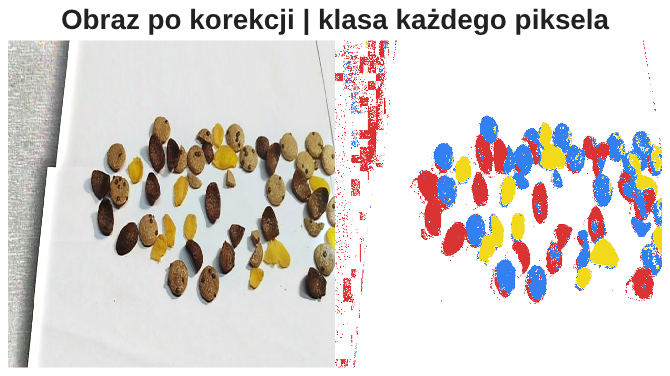
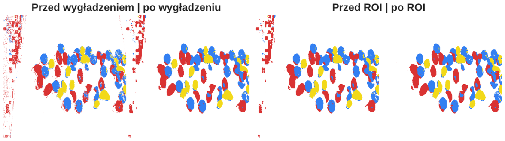
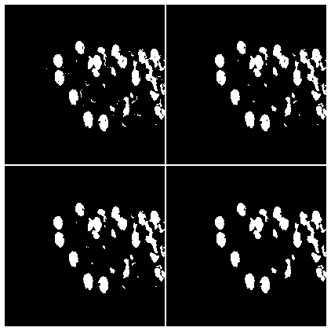
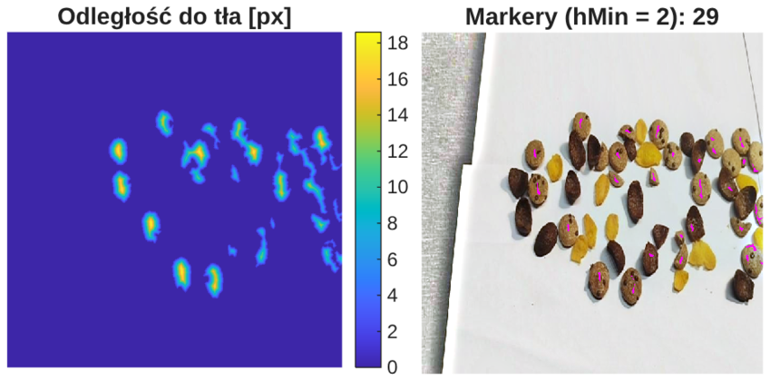
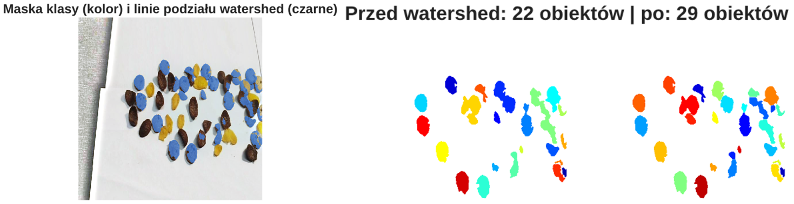
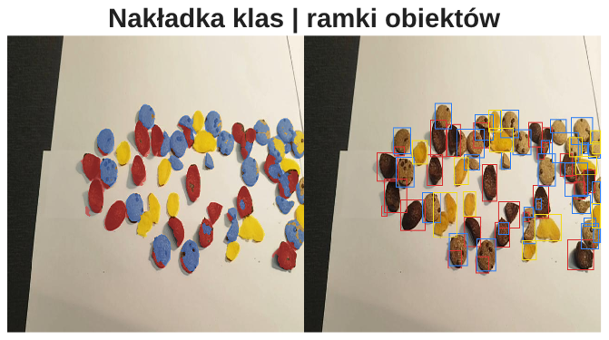

# Cel

Po etapie 3 wiemy, do jakiej klasy należy **każdy piksel**. To jeszcze nie wystarcza: chcemy wiedzieć, **ile jest płatków i gdzie leży każdy z nich**. Trzeba więc złożyć piksele w osobne obiekty. Nazywa się to [segmentacją](https://en.wikipedia.org/wiki/Image_segmentation) [1]:

- **segmentacja semantyczna**: każdy piksel ma klasę (tło, choco, cookie, corn);
- **segmentacja instancji**: dodatkowo każdy płatek ma własny numer, nawet jeśli dotyka innego płatka tej samej klasy.

Wynikiem jest mapa klas, mapa obiektów i lista obiektów (klasa, ramka, pole). Wszystkie rysunki pochodzą z jednego obrazu testowego.

# Kroki segmentacji

## Krok 1: klasa każdego piksela

Obraz poprawiamy jak w etapie 2 (wyrównanie oświetlenia, maska ROI), a potem każdemu pikselowi odczytujemy klasę z tablicy LUT z etapu 3. Wartości R, G, B dzielimy przez 4 (256 poziomów → 64), bo tyle przedziałów ma tablica.

Wynik jest dobry, ale ma wady: pojedyncze błędne piksele, np. ciemne kawałki czekolady na ciastkach (cookie) oznaczone jako choco, oraz szum na ciemnym tle po lewej stronie.

{width=75%}

## Krok 2: wygładzenie filtrem modalnym

[Filtr modalny](https://en.wikipedia.org/wiki/Mode_(statistics)) ([`modefilt`](https://www.mathworks.com/help/images/ref/modefilt.html), okno 5 × 5) [1, 4] działa jak głosowanie: każdy piksel dostaje tę klasę, która **najczęściej** występuje w jego otoczeniu 5 × 5. Pojedyncze błędne piksele zostają „przegłosowane” przez sąsiadów. To filtr nieliniowy, podobny do [filtru medianowego](https://en.wikipedia.org/wiki/Median_filter), ale działa na numerach klas. Mediana nie miałaby tu sensu, bo klasy nie mają kolejności (choco nie jest „mniejsze” od corn).

**Dlaczego 5 × 5?** Okno jest dużo mniejsze od płatka (ok. 34 px), więc nie zmienia jego kształtu, a wystarcza, żeby usunąć pojedyncze piksele i małe grupki.

## Krok 3: obcięcie do ROI

Wszystkie piksele poza maską ROI z etapu 2 (ciemny stół) ustawiamy jako tło. Znika wtedy szum po lewej stronie obrazu.

{width=100%}

## Krok 4: oczyszczenie maski każdej klasy

Od tego miejsca każdą klasę przetwarzamy osobno, jako obraz binarny („czy piksel należy do klasy c?”). Rysunek pokazuje klasę cookie.

1. **[Otwarcie](https://en.wikipedia.org/wiki/Opening_(morphology))** ([`imopen`](https://www.mathworks.com/help/images/ref/imopen.html), koło o promieniu 2 px) [2]: erozja, potem dylatacja (opisane w etapie 2). Mały element usuwa tylko cienkie „wypustki” i pojedyncze piksele, np. wąski pasek cienia łączący dwa płatki. Większych obiektów prawie nie zmienia.
2. **Wypełnienie dziur** ([`imfill`](https://www.mathworks.com/help/images/ref/imfill.html) z opcją `"holes"`) [2]: dziura to obszar tła całkowicie otoczony obiektem. W cookie takie dziury powstają w miejscach kawałków czekolady (sklasyfikowanych jako inna klasa). Płatek nie ma dziur, więc je zamalowujemy.
3. **Usunięcie małych obiektów** ([`bwareaopen`](https://www.mathworks.com/help/images/ref/bwareaopen.html), 120 px): usuwamy obiekty o polu mniejszym niż 120 pikseli. To odpowiada kwadratowi ok. 11 × 11 px, czyli dużo mniej niż typowy płatek (34 px). To są resztki szumu, a nie płatki.

{width=45%}

## Krok 5–7: rozdzielenie stykających się płatków (watershed)

Płatki często się dotykają i w masce tworzą jedną „plamę”. Żeby je rozdzielić, używamy [**transformaty wododziałowej**](https://en.wikipedia.org/wiki/Watershed_(image_processing)) (*watershed*) sterowanej znacznikami [1, 2, 6, 7].

**Krok 5: transformata odległościowa** ([`bwdist`](https://www.mathworks.com/help/images/ref/bwdist.html)) [1]. Dla każdego piksela obiektu liczymy [odległość do najbliższego piksela tła](https://en.wikipedia.org/wiki/Distance_transform). Środek płatka jest najdalej od brzegu, więc ma największą wartość (tu do ok. 18 px, czyli promień płatka). W miejscu, gdzie stykają się dwa płatki, jest „przewężenie” z mniejszymi wartościami. Plama z dwóch płatków wygląda więc jak dwa wzgórza z doliną pomiędzy.

**Krok 6: znaczniki** ([`imextendedmin`](https://www.mathworks.com/help/images/ref/imextendedmin.html), h = 2) [5]. Odwracamy mapę odległości (wzgórza stają się dołkami) i szukamy dołków **głębszych niż 2 px**. Każdy taki dołek to środek jednego płatka i zostanie osobnym obiektem. Próg głębokości jest potrzebny, bo płatki nie są idealnie okrągłe i mapa odległości ma drobne nierówności. Bez progu jeden płatek o nieregularnym kształcie zostałby pocięty na kilka kawałków (tzw. nadsegmentacja). Większe h oznacza mniej znaczników i mniej podziałów.

{width=90%}

**Krok 7: watershed** ([`imimposemin`](https://www.mathworks.com/help/images/ref/imimposemin.html), [`watershed`](https://www.mathworks.com/help/images/ref/watershed.html)). Wyobraźmy sobie odwróconą mapę odległości jako teren z dołkami. Zalewamy go wodą, która wypływa tylko ze znaczników (`imimposemin` zostawia dołki tylko tam, gdzie są znaczniki). Woda z każdego znacznika wypełnia swój dołek. Tam, gdzie spotykają się wody z dwóch różnych dołków, stawiamy „tamę”, czyli linię podziału. Te linie rozcinają stykające się płatki. Po rozcięciu jeszcze raz usuwamy małe obiekty (120 px).

{width=100%}

## Krok 8–9: lista obiektów i wynik

Kroki 4–7 powtarzamy dla każdej klasy. Następnie numerujemy osobne obiekty ([etykietowanie spójnych składowych](https://en.wikipedia.org/wiki/Connected-component_labeling), [`bwconncomp`](https://www.mathworks.com/help/images/ref/bwconncomp.html)) [3]. Używamy **spójności 4**: piksele należą do tego samego obiektu tylko wtedy, gdy stykają się bokiem, a nie rogiem. Linia watershed ma grubość 1 piksela i przy spójności 8 dwa rozcięte płatki mogłyby się „skleić” po przekątnej. Dla każdego obiektu liczymy ramkę i pole ([`regionprops`](https://www.mathworks.com/help/images/ref/regionprops.html)) [3]. Ramki są potrzebne do oceny wyników w etapie 5.

Na pokazanym obrazie znaleziono **67 obiektów** (25 choco, 29 cookie, 13 corn), a ręcznie zaznaczono 52. Część płatków została więc podzielona na więcej kawałków, niż powinna. Ocenę dokładności opisuje etap 5.

{width=80%}

W demo sprawdziliśmy, że wynik liczony ręcznie krok po kroku jest identyczny z wynikiem funkcji `segmentImage`.

## Podsumowanie: operacje, parametry i powód ich wyboru

| Krok | Co robimy | Parametr | Dlaczego |
|:-----|:--------------|:-----------|:-------------------------|
| 1 | klasa z LUT | 64 poziomy na kanał | szybka klasyfikacja każdego piksela |
| 2 | filtr modalny | okno 5 × 5 | usuwa pojedyncze błędne piksele |
| 3 | obcięcie do ROI | maska z etapu 2 | usuwa szum na ciemnym tle |
| 4 | otwarcie | koło r = 2 px | usuwa cienkie połączenia i szum |
| 4 | wypełnienie dziur | – | zamalowuje kawałki czekolady w cookie |
| 4 | usunięcie małych | 120 px | usuwa resztki mniejsze od płatka |
| 5 | transformata odległościowa | – | środki płatków = wzgórza |
| 6 | znaczniki | h = 2 px | jeden znacznik na płatek, bez nadsegmentacji |
| 7 | watershed | – | rozcina stykające się płatki |
| 8 | etykietowanie | spójność 4 | rozcięte płatki nie sklejają się po przekątnej |

# Bibliografia

1. R. C. Gonzalez, R. E. Woods, *Digital Image Processing*, wyd. 4, Pearson, 2018. Rozdz. 3 (filtry nieliniowe), 9 (morfologia) i 10 (segmentacja, watershed).
2. M. Iwanowski, S. Skoneczny, *Przetwarzanie i rozpoznawanie obrazów: preskrypt*, Politechnika Warszawska, 2009 (plik `Liniowe_i_Morfologia.pdf`). Morfologia, wypełnianie dziur, wododział.
3. *Przemysłowe Systemy Wizyjne*: materiały „Opis obrazów binarnych”, 2025. Spójność, etykietowanie obiektów, cechy obiektów.
4. *Przemysłowe Systemy Wizyjne*: wykład „Filtry medianowe”, 2025. Filtry nieliniowe.
5. P. Soille, *Morphological Image Analysis: Principles and Applications*, wyd. 2, Springer, 2003. Rozdz. 6 (minima rozszerzone, h-minima) i 9 (watershed).
6. S. Beucher, F. Meyer, „The morphological approach to segmentation: the watershed transformation”, w: *Mathematical Morphology in Image Processing*, Marcel Dekker, 1993, s. 433–481.
7. Dokumentacja MATLAB, przykład „Marker-Controlled Watershed Segmentation”, <https://www.mathworks.com/help/images/marker-controlled-watershed-segmentation.html>.

**Opisy pojęć w internecie:**

- [segmentacja obrazu](https://en.wikipedia.org/wiki/Image_segmentation), [dominanta (moda)](https://en.wikipedia.org/wiki/Mode_(statistics)), [filtr medianowy](https://en.wikipedia.org/wiki/Median_filter), [otwarcie](https://en.wikipedia.org/wiki/Opening_(morphology)), [transformata odległościowa](https://en.wikipedia.org/wiki/Distance_transform), [watershed](https://en.wikipedia.org/wiki/Watershed_(image_processing)), [etykietowanie spójnych składowych](https://en.wikipedia.org/wiki/Connected-component_labeling).
- Funkcje MATLAB: [`modefilt`](https://www.mathworks.com/help/images/ref/modefilt.html), [`imopen`](https://www.mathworks.com/help/images/ref/imopen.html), [`imfill`](https://www.mathworks.com/help/images/ref/imfill.html), [`bwareaopen`](https://www.mathworks.com/help/images/ref/bwareaopen.html), [`bwdist`](https://www.mathworks.com/help/images/ref/bwdist.html), [`imextendedmin`](https://www.mathworks.com/help/images/ref/imextendedmin.html), [`imimposemin`](https://www.mathworks.com/help/images/ref/imimposemin.html), [`watershed`](https://www.mathworks.com/help/images/ref/watershed.html), [`bwconncomp`](https://www.mathworks.com/help/images/ref/bwconncomp.html), [`regionprops`](https://www.mathworks.com/help/images/ref/regionprops.html).
