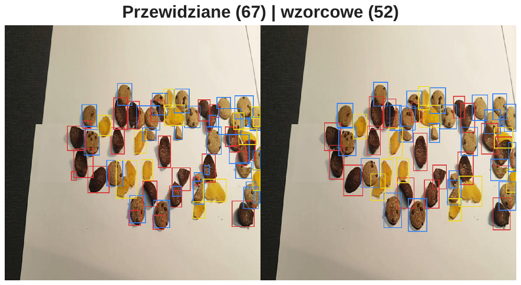
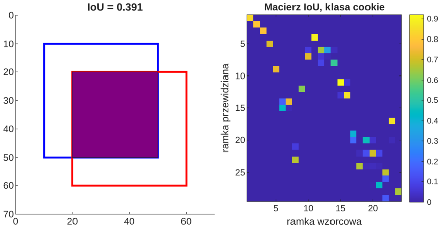
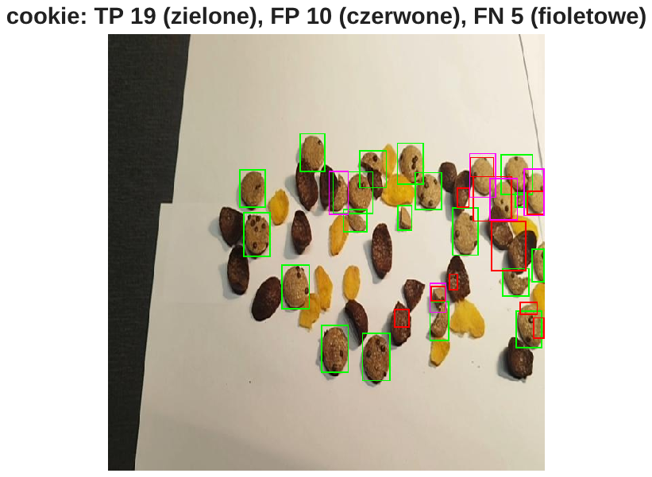
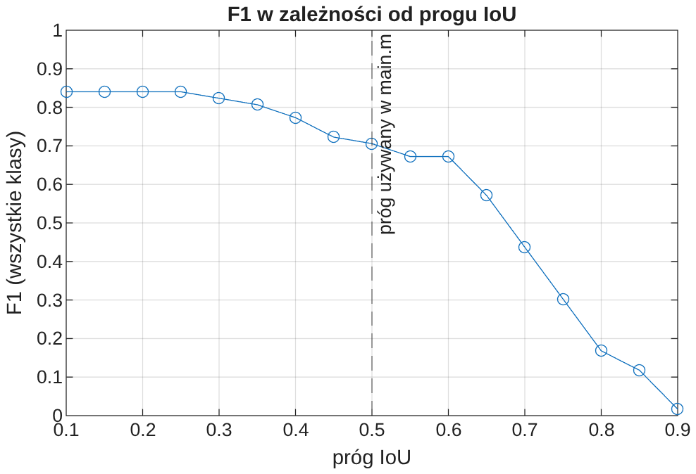

# Cel

Chcemy sprawdzić, jak dobrze działa cała metoda, czyli ile płatków znajduje poprawnie, ile pomija i ile znajduje „na niby”.

Nasz zbiór ma tylko **ramki** zaznaczone ręcznie, a nie dokładne obrysy płatków. Dlatego segmentację oceniamy **pośrednio**: każdy obiekt znaleziony w etapie 4 zamieniamy na ramkę i porównujemy z ramkami zaznaczonymi ręcznie (wzorcowymi). Tak samo ocenia się metody wykrywania obiektów w znanych konkursach PASCAL VOC i COCO [1, 2].

{width=80%}

# Jak liczymy wynik

## Krok 1: miara IoU

Żeby stwierdzić, czy dwie ramki opisują ten sam płatek, liczymy [**IoU**](https://en.wikipedia.org/wiki/Jaccard_index) (*Intersection over Union*, znane też jako indeks Jaccarda) ([`bboxOverlapRatio`](https://www.mathworks.com/help/vision/ref/bboxoverlapratio.html)) [1, 3]:

$$\text{IoU} = \frac{\text{pole części wspólnej}}{\text{pole sumy obu ramek}}$$

IoU = 1 oznacza ramki idealnie pokrywające się, a IoU = 0 ramki bez części wspólnej. Przykład z rysunku: dwie ramki 40 × 40 px przesunięte o 10 px w obu kierunkach. Część wspólna to 30 × 30 = 900 px², suma to 1600 + 1600 − 900 = 2300 px², więc IoU = 900 / 2300 ≈ 0.39. Widać, że już niewielkie przesunięcie mocno obniża IoU.

## Krok 2: macierz IoU

Dla każdej klasy osobno liczymy IoU **każdej** naszej ramki z **każdą** ramką wzorcową. Powstaje tabela (macierz), na rysunku dla klasy cookie: 29 naszych ramek × 24 wzorcowe. Większość par ma IoU = 0, bo ramki leżą daleko od siebie. Jasne pola to pary, które się pokrywają.

{width=85%}

## Krok 3: dopasowanie ramek

Każdą ramkę wzorcową można dopasować tylko do jednej naszej ramki i odwrotnie. Używamy prostego [**dopasowania zachłannego**](https://en.wikipedia.org/wiki/Greedy_algorithm) [1, 2]:

1. wybieramy z macierzy parę o największym IoU;
2. jeśli IoU ≥ **0.5**, uznajemy, że to ten sam płatek, i usuwamy obie ramki z dalszego dopasowania;
3. powtarzamy, dopóki najlepsze pozostałe IoU jest ≥ 0.5.

**Dlaczego próg 0.5?** To standardowa wartość z konkursu PASCAL VOC [1]. Wymaga wyraźnego pokrycia, a jednocześnie toleruje to, że nasze ramki z segmentacji nigdy nie będą identyczne z ramkami narysowanymi ręcznie.

Na przykładowym obrazie dla klasy cookie dopasowano 19 par (z 29 naszych i 24 wzorcowych ramek).

## Krok 4: TP, FP, FN

Po dopasowaniu każda ramka trafia do jednej z trzech grup:

- **TP** (*true positive*, trafienie): nasza ramka dopasowana do wzorcowej. Płatek znaleziony poprawnie.
- **FP** (*false positive*, fałszywy alarm): nasza ramka bez pary. Znaleźliśmy płatek, którego nie ma, albo jeden płatek pocięliśmy na kilka kawałków.
- **FN** (*false negative*, pominięcie): wzorcowa ramka bez pary. Płatek, którego nie znaleźliśmy.

{width=55%}

## Krok 5: precyzja, czułość i F1

Z tych liczb liczymy trzy standardowe miary [3, 4]:

- [**Precyzja**](https://en.wikipedia.org/wiki/Precision_and_recall) = TP / (TP + FP): jaka część znalezionych płatków jest prawdziwa. Niska precyzja oznacza dużo fałszywych alarmów.
- [**Czułość**](https://en.wikipedia.org/wiki/Precision_and_recall) (*recall*) = TP / (TP + FN): jaką część prawdziwych płatków znaleźliśmy. Niska czułość oznacza dużo pominięć.
- [**F1**](https://en.wikipedia.org/wiki/F-score) = 2 · precyzja · czułość / (precyzja + czułość): jedna liczba łącząca obie miary ([średnia harmoniczna](https://en.wikipedia.org/wiki/Harmonic_mean)). Jest wysoka tylko wtedy, gdy obie miary są wysokie.

Wynik dla przykładowego obrazu:

| Klasa | TP | FP | FN | Precyzja | Czułość | F1 |
|:------|---:|---:|---:|---------:|--------:|---:|
| choco | 14 | 11 | 3 | 0.56 | 0.82 | 0.67 |
| cookie | 19 | 10 | 5 | 0.66 | 0.79 | 0.72 |
| corn | 9 | 4 | 2 | 0.69 | 0.82 | 0.75 |

Czułość jest wyższa niż precyzja: metoda rzadko pomija płatki, ale częściej znajduje ich za dużo (głównie przez pocięcie jednego płatka na kilka obiektów w etapie 4).

## Krok 6: wpływ progu IoU

Sprawdziliśmy, jak F1 zmienia się z progiem IoU. Przy niskim progu (do ok. 0.3) F1 wynosi ok. 0.84, bo akceptujemy nawet niedokładne ramki. Przy progu 0.5 F1 spada do ok. 0.70, a powyżej 0.6 szybko maleje prawie do zera. Ramki z segmentacji zawsze trochę różnią się od ręcznych, więc bardzo wysoki próg jest nierealistyczny.

{width=60%}

# Wyniki na całych zbiorach

Ta sama ocena dla wszystkich obrazów zbioru walidacyjnego (6 obrazów) i testowego (13 obrazów), przy progu IoU = 0.5 i modelu koloru uczonym na wszystkich 144 obrazach treningowych:

| Klasa | Precyzja (valid) | Czułość (valid) | F1 (valid) | Precyzja (test) | Czułość (test) | F1 (test) |
|:------|-----:|-----:|-----:|-----:|-----:|-----:|
| choco | 0.79 | 0.86 | 0.83 | 0.72 | 0.84 | 0.77 |
| cookie | 0.81 | 0.87 | 0.84 | 0.83 | 0.90 | 0.87 |
| corn | 0.92 | 0.89 | 0.91 | 0.88 | 0.90 | 0.89 |
| **wszystkie** | **0.83** | **0.87** | **0.85** | **0.80** | **0.88** | **0.84** |

Dodatkowo policzyliśmy **średni błąd liczenia**, czyli o ile procent liczba znalezionych płatków różni się od prawdziwej: **13.9%** na zbiorze walidacyjnym i **12.8%** na testowym.

Najlepiej rozpoznawany jest corn, bo jego żółty kolor wyraźnie odróżnia się od reszty. Najsłabiej wypada choco: ma najniższą precyzję, bo ciemne cienie i kawałki czekolady na ciastkach bywają brane za płatki choco.

# Bibliografia

1. M. Everingham, L. Van Gool, C. K. I. Williams, J. Winn, A. Zisserman, „The PASCAL Visual Object Classes (VOC) Challenge”, *International Journal of Computer Vision*, t. 88, nr 2, s. 303–338, 2010.
2. T.-Y. Lin i in., „Microsoft COCO: Common Objects in Context”, w: *European Conference on Computer Vision (ECCV)*, 2014. Opis miar: <https://cocodataset.org/#detection-eval>.
3. R. Padilla, S. L. Netto, E. A. B. da Silva, „A Survey on Performance Metrics for Object-Detection Algorithms”, w: *International Conference on Systems, Signals and Image Processing (IWSSIP)*, 2020.
4. *Przemysłowe Systemy Wizyjne*: wykład „Klasyfikacja”, 2025 (plik `PrzemSysWiz_Klasyfikacja_2025.pdf`).
5. Dokumentacja MATLAB, Computer Vision Toolbox, `bboxOverlapRatio`, <https://www.mathworks.com/help/vision/ref/bboxoverlapratio.html>.

**Opisy pojęć w internecie:**

- [IoU / indeks Jaccarda](https://en.wikipedia.org/wiki/Jaccard_index), [precyzja i czułość](https://en.wikipedia.org/wiki/Precision_and_recall), [miara F1](https://en.wikipedia.org/wiki/F-score), [średnia harmoniczna](https://en.wikipedia.org/wiki/Harmonic_mean), [algorytm zachłanny](https://en.wikipedia.org/wiki/Greedy_algorithm).
